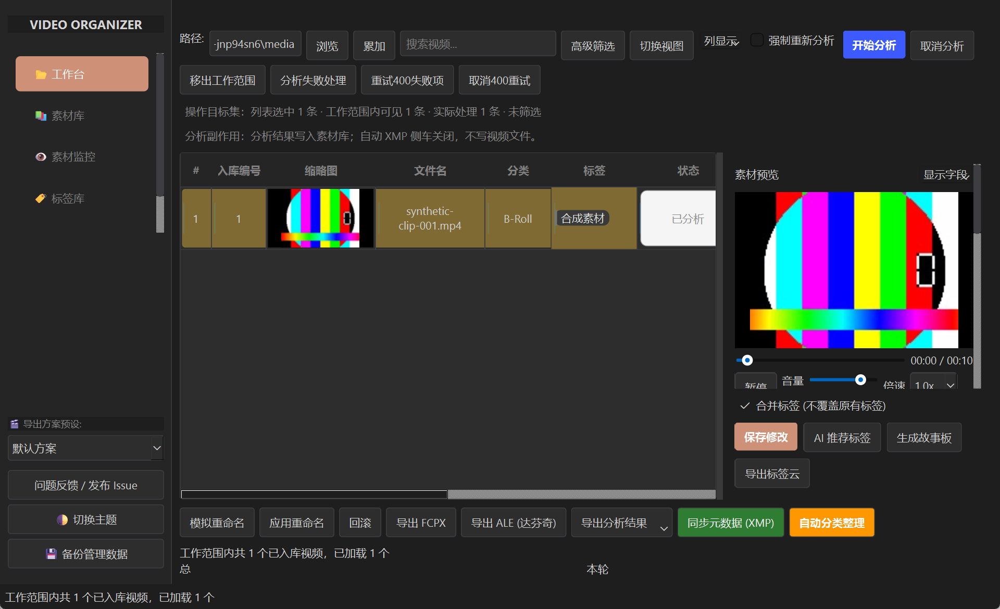

# 2026-11-21 RC11 全项目审查与修复验收

状态：本轮审查、修复、独立复核、Windows 11 全量测试和安装验收已完成；用户已授权细粒度提交、合并和发布 RC12。Windows 10 等缺失的环境验收仍未完成，详见边界。

审查基线：`f917ddf`（`v0.0.1-rc11`）。工作分支：`codex/rc11-project-review`。关联 [Issue #84](https://github.com/jiahao07A/video-organizer-pro/issues/84)，性能背景为 [Issue #81](https://github.com/jiahao07A/video-organizer-pro/issues/81)。审查完成时尚未提交、推送、合并或发布；后续交付进度见 [RC12 发布任务](../../.scratch/rc12-release/spec.md)。

## 结论与验证边界

本轮找到了会误改范围外文件、破坏媒体容器/音轨、提交过期分析结果、漏发音频请求的缺陷，也找到了真实操作无效但测试仍然通过的情况。真实安装器编译又发现注释位置回归，原生截图继续发现详情按钮裁切和播放控制遮挡。以上均已修复，经过五轮独立复核闭环。最终冻结源码 **1305项测试通过，0失败、0跳过**，对应的新安装包也通过本机验收。

验证主机为 Windows 11 x64 build 26200，Python 3.13.12；原生 Qt 窗口在主机 150% DPI 下检查。使用隔离数据库、虚构 API 凭据和合成视频，不修改个人库、配置及原始素材。

**Windows 10 未完成实际运行验收。** 已检查本机虚拟化、虚拟机工具和镜像、GitHub runner 及可用环境，未取得 Win10 系统。GitHub Windows Server runner 不能代替 Win10。安装器和固定依赖的最低条件为 Windows 10 1809 / build 17763、x64；这是兼容性要求，不是运行通过证据。不能据此宣布“所有功能在 Windows 10/11 都稳定”。

本次重新读取的官方依据：[Qt 6.10 Windows 支持表](https://doc.qt.io/qt-6.10/windows.html)列出 Windows 10 1809+ 与 Windows 11 x86_64；[Python 3.13 Windows 文档](https://docs.python.org/3.13/using/windows.html)列出 Windows 8.1+。安装器采用更严格的Qt门槛。获取的原文片段保存在 `.release-build/review-rc11-main/platform-docs.json`。

## 分工与闭环

只复用了四名代理，职责覆盖桌面、媒体数据、接口、平台。主审先收集现状与复现，再写执行包；修复交给其他职责的代理，随后再次交叉复审。执行经历五轮，包括安装器编译和原生截图中新发现的问题。主审检查实际差异、独立运行探针、全量测试和故障注入。

执行记录位于 [任务清单](../../.scratch/rc11-project-review/spec.md)、[第三轮](../../.scratch/rc11-project-review/round3.md)、[第四轮安装器](../../.scratch/rc11-project-review/round4-installer.md)、[第四轮按钮](../../.scratch/rc11-project-review/round4-gui.md)、[第五轮预览](../../.scratch/rc11-project-review/round5-preview.md)。独立结果分别见 [桌面](../../.scratch/rc11-project-review/cross-desktop.md)、[媒体](../../.scratch/rc11-project-review/cross-media.md)、[接口与基准](../../.scratch/rc11-project-review/cross-interface.md)、[导出](../../.scratch/rc11-project-review/cross-exports.md)。

## 已修问题

| 问题与影响 | 修复和实证 |
| --- | --- |
| P1：CLI 输入空目录仍可能改名库内其他素材及侧车 | 分析和改名固定为本次输入集合；空输入返回非零；真实子进程验证库外文件保持不变 |
| P1：MKV 元数据写入使用 MP4 临时容器，并丢失额外音轨 | 使用原扩展名、映射所有流和章节；前后 ffprobe 核对，不符合则保持原件；真实双音轨 MP4/MKV 通过 |
| P1：写回期间外部改变源文件，旧分析仍被记作成功 | 失败写回后重新核对内容身份、版本和人工修改；变更时拒绝提交、标记待核对；真实时序探针从成功1变为失败1，库内指纹与当前文件一致 |
| P1：音频节流异常被捕获为 API 失败，转录没有发出 | 节流交给任务调度器处理；真实抽帧、音轨提取、SDK HTTP 验证视觉与音频各一次，取消不补发 |
| 设置“验证并刷新模型”调用不存在的方法 | 改为实际 gateway 入口；按钮、后台线程、SDK、HTTP 和选中供应商鉴权共同验证 |
| 侧栏备份绕过设置落盘和后台任务门禁 | 与设置页共用维护入口；快照含刚编辑设置，忙碌时拒绝新增快照 |
| 快捷主题被设置页旧表单重新覆盖 | 同步表单、统一落盘；两种入口及写失败均验证，失败保留旧磁盘值和窗口主题 |
| 从监控高级设置跳转后侧栏不匹配，无法直接返回 | 按页面 ID 同步导航；原生点击往返验证 |
| 详情四按钮挤在一行，文字被裁切 | 复用现有FlowLayout换行；103项相关测试，两个尺寸/两个页面原生点击独立验收 |
| 小窗口播放控制超出媒体部件矩形，被表单遮挡；表单撑宽使时间/倍速文字裁切 | 单一内容滚动区、媒体控制自动换行、窄表单分行；150项相关测试通过，四场景真实鼠标/屏幕验证无需水平滚动 |
| 素材详情保存后列表仍显示旧值 | 保存后刷新查询；编辑使当前筛选失配时，记录从列表消失且数据库值正确 |
| 毫秒时间戳、NaN/Inf 等损坏更新时间使面板异常 | 重置无效时间，保留健康更新偏好；五类异常输入通过 |
| ALE 字段中的 TAB/CR/LF 破坏行列，设置列未生效 | 逐字段清理并按实际配置顺序输出；验证所有字段与四列默认布局 |
| 文档声明 JSON/CSV 导出，但缺少主动入口 | 增加工作台导出菜单和后台任务；选中/筛选/工作范围、空集和副本门禁、实际文件内容均验证 |
| 导出可覆盖定位器、设置或安装标记等管理文件 | 保护实际管理路径、备份和缩略图目录；普通目录同名文件仍允许导出 |
| FCPXML 全选副本时服务拒绝，界面仍提示成功 | 按真实返回值显示“未导出”；既有目标哨兵内容保持 |
| Windows 控制字符使改名预览成功、执行 WinError 123 | 文件名清理覆盖 C0 控制字符；TAB 等真实改名回归通过 |
| 卸载器递归删除 `_internal` 可能带走用户数据 | 移除递归清理，使用 Inno 安装清单，只单独清理生成的安装标记；未执行真实卸载 |
| 新卸载说明误放 Pascal 段使安装器不能编译 | 真实 ISCC 捕获，移至 `[UninstallDelete]` 内；以再次实际编译验收 |
| 未变的监控扫描反复打开数据库 | 复用线程私有连接，事务仍及时结束；300 个文件连接数 605→1 |
| 分析前相邻校验重复完整读取文件 | 仅复用当前发现步骤的有界收据，后续完整校验仍保留；正常链路完整哈希 5→4 次 |
| 首屏查询把大字段和全库计数一起排序 | 先处理编号与排序键，计数和分页仍同一 SQL 快照；20万条首屏由约1359ms降至约4–7ms |
| SQLite LOWER 无法匹配 Windows 非 ASCII 大小写路径 | 统一 Python 路径键，精确路径优先索引；Ü/Ö/Ä、相邻目录和排除规则验证 |
| GUI 基准混用筛选后的行数，超时和过滤失效仍报成功 | 分别核对初始首屏、期望命中数和实际模型内容；吞搜索条件的变异现确定失败 |
| 指标和连接测试存在假绿，密钥测试与实际防抖行为不符 | 固定时间精确断言；执行真实按钮到 HTTP；防抖落盘后重建服务检查密钥 |
| 中文临时路径使 OpenCV 测试误失败 | 测试读字节后 imdecode，保留真实图片解码和尺寸断言，没有跳过或删除验收 |
| 缺 ffprobe 时分析成功但没有解释未写入源文件 | 保留分析和原件，强制显示未写回的原因；README 补齐工具依赖和行为 |

## 功能验收矩阵

“通过”仅覆盖下表描述的输入和环境；自动化与隔离探针没有替代外部产品及系统的验收。

| 功能 | 本轮实际执行 | 结果或边界 |
| --- | --- | --- |
| 启动、配置和旧数据 | 全套启动升级、配置兼容、BOM、异常配置和数据目录测试；原生窗口 | 自动化及原生检查通过，最终安装复验另列 |
| 工作范围、选中、筛选、去重 | SQLite 和磁盘文件，范围隔离、副本/待核对门禁、取消入库相关用例 | 通过；CLI 越界已修 |
| 工作台、素材库、监控、标签、设置 | 5 个一级页面、9 个设置页、2 个标签页签；实际 Qt 点击、键盘和页面跳转 | 原生窗口可达，主题、导航和详情缺陷已修 |
| 预览、缩略图、列表与卡片 | 合成视频播放、4秒视频16帧观察、图片解码、视图切换、搜索；第五轮用真正屏幕截图确认彩条显示 | 通过；不是所有硬件解码器或编解码组合认证 |
| 七种视频扩展名 | mp4/mov/avi/mkv/m4v/flv/wmv 分别生成真实视频和音轨；每种完整分析产生2次真实 SDK HTTP 请求，并加载到实际 Qt 预览播放器 | 七种均成功，缩略图可解码、音频文本入库、容器/编码保留、元数据写入成功；各播放至少2个有效帧、进度推进且NoError |
| 分类、摘要、标签、音频 | 实际媒体抽取、SDK 和回环 HTTP，数据库读取结果 | 本机完整调用链通过；未调用个人付费供应商，不评价模型判断准确率 |
| 多供应商和模型路由 | 实际 `/models` 请求及鉴权、默认/功能路由测试 | 通过；不能推断所有兼容服务都实现相同协议 |
| 重试、恢复、取消、并发 | 429、500、超时、取消、节流、分层重试；9项压力 | 通过；压力抽帧使用替身，不是512个真实大视频吞吐 |
| 标签库和 AI 建议审核 | 标准词、别名、待审、分组、词表导入、建议确认、使用统计相关测试 | 通过；去别名等变异会使测试失败 |
| 重命名、预览、回滚、物理整理 | 真实临时文件、冲突和保护哨兵、失败补偿、对应 GUI 门禁 | 通过；未覆盖每种网络盘/杀毒软件/跨卷中断组合 |
| FCPXML、ALE、XMP、JSON、CSV | 真实输出、结构/字段、特殊字符、目标集和不覆盖哨兵 | 通过；未在 Final Cut Pro / DaVinci Resolve 中完成实际导入 |
| 视频内嵌元数据 | 真实 ffmpeg/ffprobe，双轨、章节、语言、标题、旋转和源变化拒绝 | 已覆盖样本通过；非所有媒体流、HDR、附件及容器变体保证 |
| 监控和补扫 | 原生监控、实际文件到达、SQLite 更新、资格检查和连接计数 | 通过；未做连续数天无人值守及断网/休眠组合 |
| 备份、恢复、管理目录搬迁 | 真实临时数据库、快照、恢复/迁移失败补偿和 UI 门禁 | 自动化通过；备份不含用户原视频 |
| 在线/离线更新和退出 | 验签、坏清单/坏包、镜像、退出/恢复用例；公网 Qt 网络探针 | 首次公网清单验签成功，最终重复探针收到 HTTP 403，当前网络可达性不稳定 |
| Windows 11 安装运行 | 第五轮新构建 EXE、Qt DLL 与包内容审计、隔离双次安装、正常退出、冻结媒体链路 | 全部通过；包内26个关键模块与最终源码一致 |
| Windows 10 | 安装器门槛和依赖兼容条件审查、环境获取调查 | **未实机验证，不能视为通过** |

七格式探针使用 MPEG-4/AAC、FFV1/PCM、FLV/MP3 和 WMV2/WMAV2 等有限组合；结果位于 `.release-build/review-rc11-main/seven-formats-b/result.json`，Qt播放器结果为同目录 `qt-preview.json`，各自保留解码后的图片。最初将 MP4 与 M4V 相同字节放在同库时正确触发去重；最终每种格式使用隔离库验证媒体链路。

## 测试效果与最终检查

| 检查 | 结果 |
| --- | --- |
| 修复前全量 | 1255 passed，9 skipped，76 warnings，902.83秒；9项压力随后单独全部通过 |
| 修复过程整套复跑 | 1285 passed，7 failed；失败涉及 CLI 控制字符、中文路径测试和 ALE 旧断言，均已修复并定向复验 |
| 第三轮源码全量 | **1301 passed，0 failed，0 skipped，81个既有Qt弃用警告，764.39秒**；显式启用9项压力测试，未处理线程异常作为错误 |
| 最终第五轮冻结源码全量 | **1305 passed，0 failed，0 skipped，81个既有Qt弃用警告，746.62秒**；再次显式执行9项压力，未处理线程异常作为错误 |
| 后续GUI专项 | 四按钮布局103项通过；第五轮滚动预览150项通过，系统鼠标及真实屏幕独立验收通过 |
| 最新定向组合 | 29 passed；媒体独立复验14 passed；导出最终专属12 passed |
| 语法和未定义符号 | compileall 通过；Ruff E9/F821/F822/F823 通过 |
| 环境依赖 | pip check 通过，运行依赖固定版本一致 |
| 修改范围 | Python/构建/测试源码冻结195个文件；第五轮已更新最终校验和，构建与整套验证绑定该快照 |

测试有效性检查使用实际故障注入，不只统计通过数：

- 去掉已分析状态集合：3项测试失败。
- 去掉标签别名归一：2项测试失败。
- 去掉重名目的地避让：1项测试失败。
- 把安装包验签函数替换为空实现：预期异常未出现，测试失败。
- 忽略指标 `started_at`：原测试仍绿；改成固定时钟、精确25.25秒后失败。
- 模型刷新原测试直接调用成功回调，绕过不存在的方法；现为实际按钮→后台线程→SDK→HTTP。
- 丢弃 GUI 搜索条件：原基准仍返回成功；修复后报告期望250、实际1250并失败。
- 详情区原几何测试只证明按钮在父面板内，漏掉文字裁切；新增实际文本宽度检查在旧布局下失败。预览控件还需检查自身边界、滚动可达和鼠标命中，避免向被遮挡的控件直接发送事件造成假绿。

动态断言审计记录全套每个用例执行结果和普通断言数量。最终1305用例执行5841个普通断言；46项没有普通 assert，对应20个独立函数，其中18个用pytest.raises检查异常，另外2个明确检查“不崩溃”。AST审计见 `.release-build/review-rc11-main/no-assert-audit.json`，执行数据见同目录 `assertions-final.json`，最终JUnit报告为 `final-preview.xml`，汇总为 `final-evidence.json`。全量结束后195个源码/测试/构建文件校验和仍与最终冻结清单一致。没有普通 assert 不等于无效，有 assert 也不能保证检错充分。此次对全套执行和断言方式作审计、对重点行为作变异验证，**没有穷举每个测试的一切错误实现**。

原生截图探针曾因连续 QTest.qWait 占用 Python 执行机会，导致3个缩略图任务无法及时结束。替换成 processEvents 与短暂 sleep 后任务清空，close和close_accepted均为True、进程退出0。这是验证脚本问题，未为它修改产品退出逻辑。

第五轮原生验收通过Windows系统鼠标/键盘事件操作，而非向指定隐藏控件直接发送Qt事件。1280×780与1554×930两种逻辑尺寸、工作台和素材库四场景均验证：水平滚动最大值0、真实滚轮到达字段、播放与暂停、2倍速继续播放、编辑保存落盘、正常退出。真正屏幕截图的四个视频区域均显示彩条，排除了只看播放计时的假通过。证据目录为 `.release-build/review-rc11-desktop/round5-preview-final/`。

以下保留1280×780逻辑尺寸、150% DPI的真实屏幕截图，仅含合成媒体及隔离测试目录；右侧详情支持纵向滚动，窗口内显示的是当前滚动位置。

## 性能结果与剩余瓶颈

| 场景 | 基线与当前 | 解释 |
| --- | --- | --- |
| 20万条目录首屏100条 | 基线中位约1359ms；修后独立样本4–7ms | 不再全量排序/搬运摘要等大字段 |
| 20万条目录范围筛选 | 独立样本约357–469ms | 路径规范化与范围匹配仍需扫描，超大库应继续关注 |
| 20万条状态筛选 | 约45–55ms | 本机合成数据结果，不是所有电脑承诺 |
| 300个未变文件补扫 | 605连接→1；主审约1.254秒→0.056秒 | 连接复用保留独立事务边界 |
| 正常媒体分析哈希 | 5次完整读取→4次 | 大视频/慢磁盘仍可能受多次完整哈希限制；未为了速度跳过结果提交前的校验 |
| GUI检索50/1250/50000条 | 首屏50/100/100；命中0/250/1000；单次检索约193/211/226ms | 包含界面防抖，核对结果后才报告耗时 |
| 回环压力 | 9场景，共3136请求；应用512条×2轮均成功；网关峰并发64/128/256 | 包含429/500恢复、32请求短超时、256排队取消后仅32已发出 |

两轮应用压力结束线程数回到27–28；内存峰值约129/149MB，结束约120/144MB。短时间两轮没有显示持续线程泄漏，但不足以证明长期内存稳定。完整压力明细见 `.release-build/review-rc11-api/stress.json`。

## 构建产物与未完成条件

最终有效产物为 `.release-build/review-rc11-final-build-c`、`review-rc11-final-installer-c` 和 `review-rc11-final-installed-b`。PyInstaller构建退出0；Qt DLL加载通过；work和EXE两份归档的26个关键模块（包括两个最终GUI部件）与冻结源码一致；包内未混入个人设置、数据库、日志或私钥。

| 产物 | 字节数 | SHA-256 |
| --- | --- | --- |
| `VideoOrganizer.exe` | 19,935,205 | `583e44f3ce28e3a3244dfa62fc9f17cb42fa37cdc28af6d1f3e6cd30f58a712a` |
| `VideoOrganizer-v0.0.1-rc11-isolated-smoke.exe` | 166,653,382 | `9ecb58d364b207441786eeb4e1d2bc2da10e614ff351a81c13744b57cd5fad56` |

主审重新计算了上述摘要，并核对已安装EXE与目录包一致。最终真实冻结媒体链路耗时3.011秒，一次HTTP请求含两帧，12个解码帧在元数据写入前后逐帧相同，SQLite、缩略图、指纹、内容版本、监控状态及旁路哨兵均符合预期。探针只终止其自己启动的进程，这一动作不充当正常退出证据。

正常退出另由双次隔离安装验证：安装脚本退出0，安装后的应用正常退出0，更新核对completed，自选管理目录、1条数据库记录和设置保留，没有生成意外空库。证据为 `review-rc11-final-installed-b/result.json`；构建记录为 [final-platform.md](../../.scratch/rc11-project-review/final-platform.md)。

构建产物均位于 `.release-build/`，隔离安装器标有 `isolated-smoke`，不能公开发布。未执行正式安装覆盖或真实卸载；没有清理用户文件或批量删除目录。

仍缺的发布级证据包括：Win10实际运行、真实外部AI供应商稳定性与输出质量、剪辑软件实际导入、长期无人值守、广泛编解码/硬件/文件权限组合、真实卸载。当前公网更新检查还出现一次403。以上不能由本轮自动化通过数替代。

用户确认修改完成、无已知问题并批准后，才按仓库要求创建包含功能与技术说明的提交。
